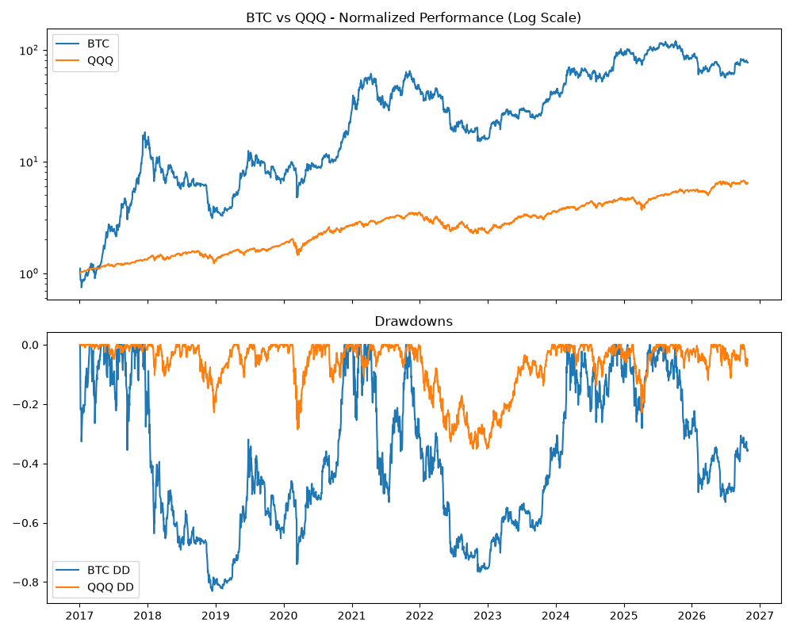

# BTC vs Nasdaq
[](https://github.com/charles030992/btc-vs-nasdaq/actions/workflows/ci.yml)

Estado: funcional

Compara Bitcoin con el Nasdaq-100 (ETF `QQQ`) en rentabilidad, riesgo y caídas máximas, con datos de Yahoo Finance. Genera un gráfico y un informe en Excel.

> Análisis con fines educativos. No es asesoramiento financiero ni una recomendación de inversión. La rentabilidad pasada no garantiza resultados futuros.

## Resultado

Periodo 2017-01-03 → 2026-10-28 (9,8 años, 2.469 observaciones), calculado el 28-oct-2026:

| | CAGR | Volatilidad (anual) | Máx. drawdown | Rentabilidad total | Sharpe (rf=0 %) |
|---|---:|---:|---:|---:|---:|
| **BTC** | 55,7 % | 66,6 % | −83,0 % | 7.598 % | 1,00 |
| **QQQ** | 20,9 % | 22,7 % | −35,1 % | 545 % | 0,95 |



Bitcoin ha rendido mucho más, pero con una volatilidad unas tres veces mayor y una caída máxima más del doble de profunda. Por unidad de riesgo la diferencia es pequeña (Sharpe 1,00 frente a 0,95).

Los datos se descargan al ejecutar el script, así que los números cambian con cada ejecución (`--start` también los cambia mucho: desde 2020, el CAGR de BTC baja a 43 %).

## Cómo usarlo

Requisitos: Python 3.11+.

```bash
python -m venv .venv
.venv\Scripts\activate            # Linux/macOS: source .venv/bin/activate
pip install -r requirements.txt

python btc_vs_nasdaq.py
python btc_vs_nasdaq.py --start 2020-01-01 --risk-free 0.03
python -m unittest discover -s tests -t .
```

Opciones: `--start` (fecha de inicio), `--risk-free` (tasa libre de riesgo anual para el Sharpe, por defecto 0), `--output-dir` (por defecto `output/`) y `--show` (mostrar el gráfico).

Salida: `output/btc_vs_qqq.png` y `output/btc_vs_qqq_report.xlsx` (precios, rendimientos, índice, drawdown y métricas).

## Metodología

- **Datos:** cierres ajustados de Yahoo Finance. En QQQ incluyen dividendos reinvertidos; BTC no paga.
- **Alineación:** BTC cotiza los 365 días y QQQ solo en días de bolsa. La muestra se alinea en las fechas comunes (días de bolsa), unas 251 al año, y todas las métricas se calculan sobre ella.
- **CAGR:** en tiempo natural (años entre la primera y la última fecha), igual para los dos activos.
- **Volatilidad y Sharpe:** se anualizan con las observaciones reales por año de esa muestra. Sharpe = (rentabilidad media anual − tasa libre de riesgo) / volatilidad.
- **Drawdown:** caída desde el máximo anterior del índice normalizado (que empieza en 1).

### Corrección importante

Hasta el 28-oct-2026 el script anualizaba BTC con 365 periodos y QQQ con 252 sobre una muestra que solo tiene días de bolsa. Eso inflaba las métricas de BTC (CAGR de ~90 % en lugar de ~56 %, volatilidad de ~80 % en lugar de ~67 %). Los informes generados antes de esa fecha sobrestiman a BTC. Un test con series sintéticas fija ahora el cálculo correcto.

## Limitaciones

- Con la muestra alineada se pierden los mínimos de BTC en fin de semana: con su calendario completo, el drawdown máximo es −83,4 % en lugar de −83,0 %.
- El Sharpe usa rf=0 por defecto; con un tipo libre de riesgo realista baja para ambos.
- Sin costes de transacción, impuestos ni comisiones. Ambos activos están en dólares.
- Es una comparación de dos series, no un análisis de correlación ni de carteras combinadas.
- La ventana temporal elegida condiciona el resultado.
